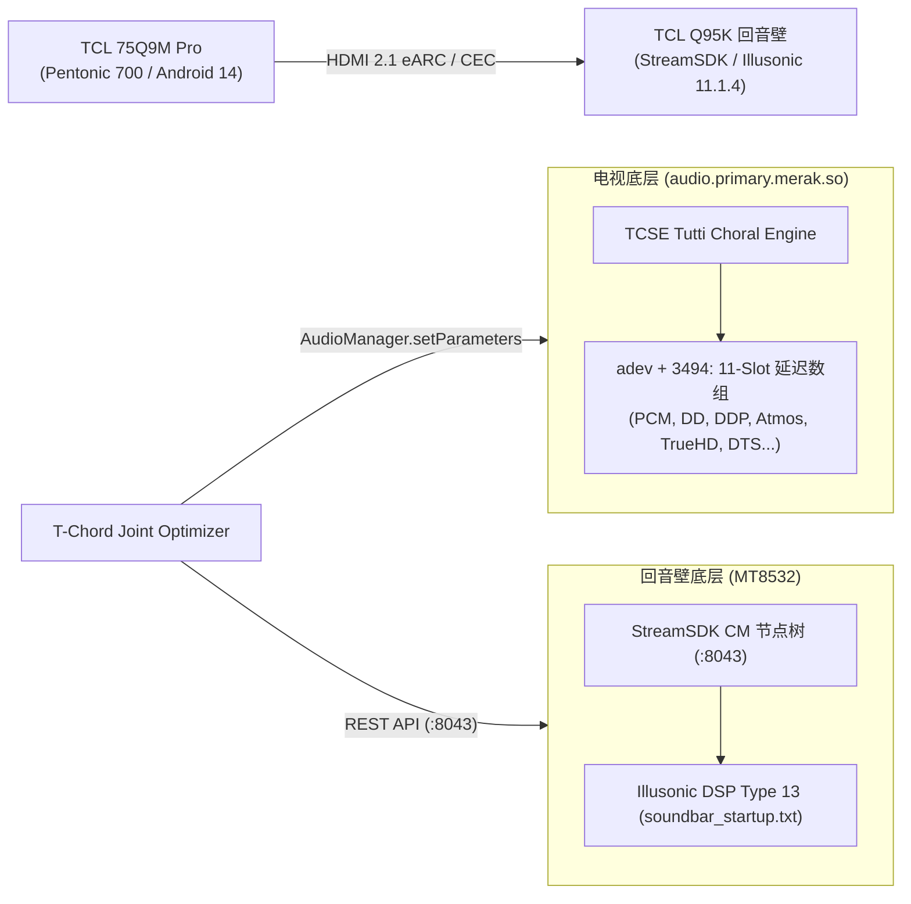

# TCL T-Chord Joint Optimizer (TCL T和弦声学协同优化中枢)

[](LICENSE)
[-orange.svg)](docs/REVERSE_ENGINEERING_TV_HAL.md)
[-blueviolet.svg)](docs/REVERSE_ENGINEERING_SOUNDBAR.md)
[](docs/REVERSE_ENGINEERING_SOUNDBAR.md)

**TCL T-Chord Joint Optimizer** 是针对 **TCL 旗舰电视（如 75Q9M Pro 等搭载联发科 Pentonic 700 / MT9653 平台）** 与 **TCL 旗舰回音壁（如 Q95K 11.1.4 搭载 StreamSDK + Illusonic DSP 平台）** 的专业级声学联合优化与校准套件。

本项目通过对电视底层 Audio HAL 驱动及回音壁内部流媒体 DSP 架构的全链路逆向工程，破解了原厂 T 和弦（Tutti Choral）的关键控制参数，彻底消除了原厂方案因时延估计粗糙引起的**人声梳状滤波相位抵消**与**电视外壳低频共振**问题。

---

## 1. 为什么需要优化原厂 T 和弦？

| 痛点问题 | 原厂默认现象 | 本优化方案解决策略 |
| :--- | :--- | :--- |
| **关键人声频段空洞（梳状滤波）** | 原厂通过 HDMI-CEC 估算回音壁延迟，存在 10–20ms 误差。声波声程差导致 1kHz–4kHz 人声关键频段发生严重反相干涉抵消，听感单薄、有空洞感。 | 提取底层 11 编解码器时延槽位，提供微秒级精准物理相位对齐，使两端声波在听音位实现同相干叠加。 |
| **电视机身塑料背壳低频共振** | 原厂将全频音频直接推给电视扬声器，低音引发塑料腔体剧烈共鸣，且与回音壁独立的 10 吋大口径低音炮产生杂乱低频抵消。 | 引入 350Hz 陡峭高通分频，彻底切除电视扬声器的低频负担，低频下潜完全由回音壁低音炮纯净呈现。 |
| **大屏对白声像下陷** | 75 吋以上大屏幕观影时，原厂声场偏低，声音明显来自底部的回音壁，造成音画脱节。 | 注入垂直声场抬升参数与 HRTF 高度补偿滤镜，将人声对白声像精准“站立”并拉回至屏幕画面正中央。 |

---

## 2. 系统拓扑与逆向工程发现



### 关键逆向证据
1. **电视端 MediaTek Audio HAL (`audio.primary.merak.so`)**：
   * 在反汇编中证实，参数 `AQ_TCSE_TUTTI_CHORAL_SBAR_LATENCY` 接收由逗号切分的字符串，并通过 `atoi` 存入结构体偏移 `0xda6`（十进制 `3494`）的 11 项 16-bit 整数数组：
     $$\text{Slot } [0\dots 10] = [\text{PCM},\ \text{DD},\ \text{DDP},\ \text{DDP\_Atmos},\ \text{TrueHD},\ \text{TrueHD\_Atmos},\ \text{MAT},\ \text{DTS},\ \text{DTS-HD},\ \dots]$$
   * 详见 [电视端 HAL 逆向工程深度分析文档](docs/REVERSE_ENGINEERING_TV_HAL.md)。
2. **回音壁端 StreamUnlimited StreamSDK 与 Illusonic DSP**：
   * 证实回音壁运行 `Linux 6.1.0-mainline`，搭载瑞士 **Illusonic DSP**（Type 13），并通过本地端口 `8043` 开放 REST API。
   * 详见 [回音壁端逆向工程深度分析文档](docs/REVERSE_ENGINEERING_SOUNDBAR.md)。

---

## 3. 快速上手与部署指南

### 环境要求
* 一台局域网内的 Linux / macOS / Windows 主机（Python 3.8+）
* 目标 TCL 电视与 TCL 回音壁已接入同一局域网并完成 HDMI eARC 连接

### 一键部署方案

#### 步骤 1：克隆项目
```bash
git clone https://github.com/EBOLABOY/tcl-tchord-optimizer.git
cd tcl-tchord-optimizer
```

#### 步骤 2：查看并校准配置
查看各编解码器的出厂默认微秒校准表：
```bash
python3 t_chord_joint_orchestrator.py --show-params
```

#### 步骤 3：注入与协同对齐
运行调度脚本，自动连通回音壁与电视：
```bash
python3 t_chord_joint_orchestrator.py --soundbar-ip 192.168.100.134 --tv-ip 192.168.100.101
```

---

## 4. 安全保障与 100% 物理回退承诺

本工具严格遵守非破坏性原则：
1. **零磁盘修改（Zero Disk Write）**：全程不修改系统只读分区（`/system`、`/vendor`），不修改驱动二进制文件，AVB 2.0 / dm-verity 强校验永远保持原厂完整性，**绝无变砖或无法开机风险**。
2. **纯 RAM 运行时生效**：参数仅常驻于系统的当前内存变量中。
3. **开机即彻底恢复（Reboot-to-Factory）**：如果想完全撤销所有调优，只需**重启电视或拔插电源**，所有参数自动清零还原为出厂状态。

---

## 5. 项目结构

```
├── configs/
│   └── default_codec_latency.json      # 11 编解码器时延基准与分频配置
├── docs/
│   ├── REVERSE_ENGINEERING_TV_HAL.md   # 电视 MediaTek Audio HAL 反汇编分析
│   ├── REVERSE_ENGINEERING_SOUNDBAR.md # 回音壁 StreamSDK 与 Illusonic DSP 深度分析
│   └── ACOUSTIC_TUNING_GUIDE.md        # 室内空间声学计算与分频调音指南
├── injector/
│   └── src/
│       └── TChordInjector.java         # Android 原生反射音频参数注入器
├── scripts/
│   ├── push_injector.py                # T-Cast 原生静默推送安装工具
│   └── tcl_remote.py                   # T-Cast 遥控联动工具
├── t_chord_joint_orchestrator.py       # 联合声学优化调度主程序
├── LICENSE                             # MIT 开源协议
└── README.md                           # 项目说明文档
```

---

## 6. 开源协议

本项目基于 [MIT 协议](LICENSE) 开源。仅供家庭影院声学爱好者交流学习与非商业音频调谐使用。
