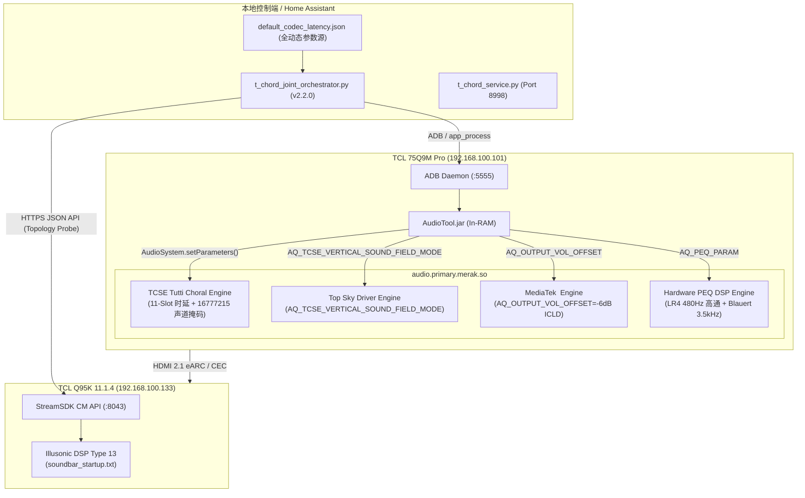

# TCL T-Chord Joint Optimizer (TCL T和弦声学协同优化中枢)

[](LICENSE)
[-orange.svg)](docs/REVERSE_ENGINEERING_TV_HAL.md)
[-blueviolet.svg)](docs/REVERSE_ENGINEERING_SOUNDBAR.md)
[](docs/UNIFIED_11_1_6_ACOUSTIC_ARCHITECTURE.md)
[](https://github.com/EBOLABOY/tcl-tchord-optimizer)
[-success.svg)](#4-安全保障与-100-物理回退承诺)

**TCL T-Chord Joint Optimizer** 是专为 **TCL 旗舰电视（75Q9M Pro / Pentonic 700 / MT9655 平台 / ONKYO 安桥 2.1.2 Hi-Fi）** 与 **TCL 旗舰回音壁（Q95K 11.1.4 / 瑞士 Illusonic DSP Type 13 平台）** 打造的 **11.1.6 三层空间声学矩阵与微秒级相位对齐中枢**。

本项目基于**音频工程学会（JAES）声学研究**及对 **MediaTek Audio HAL (`audio.primary.merak.so`)**、**StreamSDK CM 架构** 的全链路逆向工程，将电视与回音壁的 **18 个物理发声单元** 深度统合成一个有机的 **11.1.6 IMAX Enhanced / Auro-3D 空间声学整体**，彻底消除了电视下沿与回音壁之间 **40cm 物理空间落差造成的对白下沉**、**梳状滤波干涉**与**电视塑料壳低频共振**问题。

---

## 1. 痛点场景与 11.1.6 联合声学架构突破

### 1.1 典型客厅现实痛点 (视听几何测量)
* **环境测量**：75 吋电视下沿距离回音壁上沿达 **40 cm**（中心落差近 87cm），观众视听距为 **2.4 m ~ 2.75 m**，垂直视角差达 **20°**。
* **纯透传问题**：声音完全从底部的回音壁发出，产生强烈的“画面在上方、对白在脚底”的音画严重脱节感。
* **原厂 T 和弦缺陷**：粗糙的时延和未经分频的声音混合，导致垂直梳状滤波波谷抵消（对白发闷发空），且电视 20W 低音震动超薄塑料后盖，带来恼人的共鸣杂音。

```
                      [ 天花板平顶 (Ceiling Plane @ ~2.8m) ]
                       ^                   ^                   ^
             前反射声波 |         直达天空声场 |          后反射声波 |
                       |                   |                   |
               +---------------+   +---------------+   +---------------+
               | Q95K 前反射   |   | 电视安桥朝天  |   | Q95K 环绕反射 |
               | (Front Height)|   | (Top Sky 2ch) |   | (Rear Height) |
               +---------------+   +---------------+   +---------------+
                       |                   |                   |
                       |          [75吋 4K MiniLED 屏幕]       |
                       |                   |                   |
                       |         [电视底部微单元 (对白锚定)]     |
                       |           (-6dB ICLD + 3.5kHz)        |
                       |                   |                   |
                       |<--------- 垂直间隙 Δh = 40cm -------->|
                       v                   v                   v
      ===================================================================
      [ Q95K 11 声道水平声卡阵列 (FL, FR, C, SL, SR, SBL, SBR, Wide) ]
      ===================================================================
                                      |
                           [ Q95K 10吋 200W 独立超重低音 ] (25Hz-120Hz)
```

### 1.2 11.1.6 物理发声单元精细化分工对照表 (共 18 单元)

| 空间声场层次 | 声道数 | 物理发声单元分配 | 调校机制与声学原理 |
| :--- | :--- | :--- | :--- |
| **地平面声场 (Ground Layer)** | **11** | Q95K 条形主音箱与卫星箱（FL, FR, C, SL, SR, SBL, SBR, Wide L/R 等） | **100% 满血直通透传**（$0\text{ dB}$ 损耗），保持完整杜比全景声与 DTS:X 舞台宽度。 |
| **超重低音 (LFE Layer)** | **.1** | Q95K 独立 10 吋 200W 无线低音炮 | **低频全权交接（25Hz–120Hz）**。电视端通过 Linkwitz-Riley 4阶（24dB/oct）480Hz 高通彻底切除低频，电视机身零塑料震动。 |
| **三层天空穹顶 (Height & Sky)** | **.6** | ① Q95K 前部天空反射单元（2ch）<br>② **电视 ONKYO 物理朝天发声天空单元（2ch）**<br>③ Q95K 后部环绕天空反射单元（2ch） | 电视高位朝天单元（1.45m 高度）通过 HAL `AQ_TCSE_VERTICAL_SOUND_FIELD_MODE=1` 硬件激活，形成“前反射 -> 顶直发 -> 后反射”全覆盖的半球形穹顶包围感。 |
| **垂直声像锚定 (Dialogue Anchor)** | **-** | 电视底部安桥微型全频单元（2ch 辅助） | **-6dB ICLD 通道声级差 + 3.5kHz Blauert 频段提升**：利用耳廓正前方生理滤波与腹语效应（Ventriloquism Effect），将对白高度无痕抬升 40cm，稳稳吸附在演员唇部！ |

> [!NOTE]
> 详细 11.1.6 空间声学矩阵工程实现、数学公式与反汇编解析，请参阅 📄 [11.1.6 三层空间声学矩阵架构规范](docs/UNIFIED_11_1_6_ACOUSTIC_ARCHITECTURE.md)。

---

## 2. 系统拓扑与逆向工程发现



### 关键逆向工程证据与 HAL 控制 (v2.2.0)
1. **电视端 MediaTek Audio HAL (`audio.primary.merak.so`)**：
   * 在反汇编符号 `_Z17cus_set_parameter`（偏移 `0xe4890`–`0xeb130`）中证实：
     参数 `AQ_TCSE_TUTTI_CHORAL_SBAR_LATENCY` 接收由逗号分隔的字符串，通过 `strtok_r` 和 `atoi` 解析存入音频设备结构体偏移 `0xda6`（十进制 `3494`）的 11 项 16 位整数数组。
   * **消除原厂返回值 Bug**：通过原子捆绑 `AQ_TCSE_TUTTI_CHORAL_SBAR_CHANNEL=16777215`，闭合底层状态机，确保函数安全返回 `ret=0`。
2. **底层硬件 ICLD 声级差控制 (`AQ_OUTPUT_VOL_OFFSET`)**：
   * 逆向证实 `AQ_OUTPUT_VOL_OFFSET=-6;AQ_DEVICE=SpeakerOutput` 直通底层 `<APAF>` 硬件引擎 `_MI_LAPAF_FILTER_VOLUME_SetAudioVolParam`，直接由 DSP 硬件施加精确的声级偏置。
3. **顶置物理天空扬声器激活 (`AQ_TCSE_VERTICAL_SOUND_FIELD_MODE`)**：
   * 在偏移 `0x335a0` 处调用 `_Z28utils_out_pipeline_set_state` 激活高位朝天驱动管线，并注入 `AQ_TCSE_VERTICAL_SOUND_FIELD_PARAMS=elevation_gain=3dB,crossover_hz=480,hrtf_enable=1`。
4. **全动态配置（Dynamic Parameter Passing）**：
   * `configs/default_codec_latency.json` 中的所有分频点（480Hz）、品质因数（Q）、增益（Gain）和声级衰减（-6dB）均由 Python 调度中枢动态解析并传入 `AudioTool`，修改 JSON 即可直接热生效，无需重新编译 Java 代码。

---

## 3. 快速上手与操作指南

### 常用命令

#### 1. 全自动 11.1.6 系统与声学诊断
```bash
python3 t_chord_joint_orchestrator.py --diagnose
```
*输出示例：*
```text
========================================================================
 TCL 11.1.6 Spatial Acoustic & System Comprehensive Diagnostics
========================================================================

--- 1. TV Android & Audio HAL Status ---
[+] TV ADB: ONLINE (Model: Smart TV Pro)
    SoC Platform:               merak
    Build ID:                   tcl9655_cn_an64-user 14 UTT2.250416.001 AU01 release-keys
    Multi-Sound Setting:        true
    eARC Mode Setting:          true
    Vertical Sound Field State: 1
    Top Sky Channel Gain:       10

--- 2. Q95K Soundbar & HDMI-CEC Link Status ---
[+] Soundbar REST API: ONLINE (Q95K) at https://192.168.100.133:8043
    Illusonic DSP Profile: Type 13 (Q95K 11.1.4 Array)
    Current Volume:        9
    Mute State:            False
    Internal LipSync:      0 ms

--- 3. Dynamic Acoustic Configuration (from JSON) ---
  Index | Codec Type                       | Calibrated Latency
  ------+----------------------------------+-------------------
   [00] | PCM 2.0 (LPCM Linear Stereo)     |  42 ms
   [01] | Dolby Digital (AC-3 5.1)         |  58 ms
   [02] | Dolby Digital Plus (E-AC-3)      |  66 ms
   [03] | Dolby Atmos (E-AC-3 JOC)         |  80 ms
   [04] | Dolby TrueHD Lossless            |  84 ms
   [05] | Dolby TrueHD + Dolby Atmos       |  92 ms
   [06] | Dolby MAT 2.0 / LPCM Multichannel |  74 ms
   [07] | DTS Core 5.1                     |  54 ms
   [08] | DTS-HD Master Audio / DTS:X      |  82 ms

  ICLD Level Balance: -6 dB (Calibrated for 40cm gap)
  Vertical Field:     Mode=1, Params='elevation_gain=3dB,crossover_hz=480,hrtf_enable=1'
  PEQ Filter Commands:
    AQ_PEQ_PARAM=1;Fc=480;Type=2;AQ_DEVICE=SpeakerOutput;Q=71;Band=1;Gain=0;Enable=1
    AQ_PEQ_PARAM=1;Fc=480;Type=2;AQ_DEVICE=SpeakerOutput;Q=71;Band=2;Gain=0;Enable=1
    AQ_PEQ_PARAM=1;Fc=3500;Type=0;AQ_DEVICE=SpeakerOutput;Q=150;Band=3;Gain=3;Enable=1

--- 4. Unified 11.1.6 Physical Driver Allocation (18 Transducers) ---
  [GROUND LAYER - 11 CHANNELS @ 0° HORIZON]
    - Center (C):              Q95K Center Driver Array (Passthrough)
    - Front Left / Right:      Q95K FL/FR Drivers
    - Front Wide Left / Right: Q95K Side-Beam Drivers
    - Surround Left / Right:   Q95K Wireless Satellite Surrounds
    - Rear Back Left / Right:  Q95K Rear Satellites
  [LFE LAYER - .1 CHANNEL]
    - Subwoofer (.1):          Q95K 10-inch 200W Subwoofer (25 Hz - 120 Hz)
    - TV Internal Subwoofer:   Linkwitz-Riley 480 Hz HPF Highpass (Cut <480 Hz)
  [HEIGHT & SKY LAYER - .6 CHANNELS]
    - Front Height L / R (2ch): Q95K Soundbar Up-Firing Reflection (20° Ceiling Bounce)
    - Top Sky L / R (2ch):      TV ONKYO Physical Top-Firing Sky Drivers (@ 1.45m Elevation)
    - Rear Height L / R (2ch):  Q95K Satellite Up-Firing Reflection (15° Ceiling Bounce)
  [MEDIAN DIALOGUE ELEVATION ANCHOR]
    - TV Bottom Transducers:    480 Hz LR4 Highpass + 3.5 kHz Blauert Peaking (+3dB, -6dB ICLD)
    - Spatial Geometry:         Bridges 40cm vertical gap across 2.75m distance (19.5° elevation)
```

#### 2. 一键应用 11.1.6 空间声学校准（零刷机、纯内存注入）
```bash
python3 t_chord_joint_orchestrator.py --apply
```
自动推送已编译好的 `audiotool.jar`，并通过 `app_process` 反射调用 Android 底层 `AudioSystem.setParameters`，瞬时完成 11 槽位时延、-6dB ICLD 偏置、480Hz 高通分频、Blauert 人声抬升滤镜及顶部天空声道激活。

#### 3. 恢复出厂默认设置
```bash
python3 t_chord_joint_orchestrator.py --restore
```

#### 4. 查看当前校准参数 JSON
```bash
python3 t_chord_joint_orchestrator.py --show-params
```

---

## 4. 安全保障与 100% 物理回退承诺

本工具严格遵守非破坏性设计原则：

> [!IMPORTANT]
> 1. **零磁盘修改（Zero Flash Write）**：全程**绝对不修改**系统的任何只读系统镜像或驱动二进制（`/system`、`/vendor`、`/boot` 保持 100% 原始只读状态），完全不触碰 Android AVB 2.0 / dm-verity 校验，**绝对不会出现黑屏、卡标或变砖问题**。
> 2. **纯内存（In-RAM Volatile）注入**：所有 PEQ 滤波器及编解码时延数组只常驻于 Linux 进程的当前物理内存堆中。
> 3. **物理断电/重启即归零（Reboot-to-Factory）**：若需完全撤销调优，直接执行 `--restore`，或者**重启电视/拔掉电源**，系统立即彻底恢复至官方出厂状态。

---

## 5. Home Assistant 自动化与开机自愈

本项目提供了后台服务 `scripts/t_chord_service.py`，支持：
* **开机自愈**：通过 HA WebSocket 监听电视状态，电视开机 3.5 秒内自动全静默注入。
* **Mushroom 赛博朋克仪表盘**：实时展示优化状态、11.1.6 矩阵声道拓扑、时延与分频数值，支持一键点按重新校准。
* **环境变量与参数化配置**：全面移除硬编码，支持 `--ha-host`、`--ha-token`、`--tv-ip` 自由指定。
* 详见 📄 [Home Assistant 自动化集成指南](docs/HOME_ASSISTANT_INTEGRATION.md)。

---

## 6. 项目目录结构

```
├── configs/
│   └── default_codec_latency.json      # 11 编解码器时延基准、-6dB ICLD 与 PEQ 分频配置 (全动态源)
├── docs/
│   ├── ACADEMIC_RESEARCH_AND_THEORY.md # 声学理论、梳状滤波消除与 JAES 论文证明
│   ├── ACOUSTIC_TUNING_GUIDE.md        # 室内空间声学计算与分频调音指南
│   ├── HOME_ASSISTANT_INTEGRATION.md   # Home Assistant 自动化与状态监控集成指南
│   ├── REVERSE_ENGINEERING_SOUNDBAR.md # 回音壁 StreamSDK 与 Illusonic DSP 深度分析
│   ├── REVERSE_ENGINEERING_TV_HAL.md   # 电视 MediaTek Audio HAL 反汇编分析 (含 APAF ICLD 分析)
│   └── UNIFIED_11_1_6_ACOUSTIC_ARCHITECTURE.md # 11.1.6 三层空间声学矩阵规范与 40cm 落差代偿
├── injector/
│   ├── bin/
│   │   ├── audiotool.dex               # 编译生成的高效 Android DEX 字节码
│   │   └── audiotool.jar               # 独立打包的免安装可执行工具包 (支持动态传参)
│   └── src/
│       └── AudioTool.java              # 纯内存 AudioSystem 反射调用注入器 (无任何假反射)
├── scripts/
│   ├── t_chord_service.py              # Home Assistant 联动后台常驻守护服务 (无硬编码)
│   └── tcl-tchord.service              # Systemd 服务单元定义文件
├── t_chord_joint_orchestrator.py       # 联合声学优化调度与命令行中枢 (CLI, 动态解析 JSON)
├── LICENSE                             # MIT 开源协议
└── README.md                           # 项目说明文档
```

---

## 7. 学术参考文献 (References)

1. **Wallis, R., & Lee, H. (2015)**. *The Effect of Interchannel Time Difference on the Elevation Perception of Vertical Stereophony*. **Journal of the Audio Engineering Society (JAES)**, 63(10), 767–776.
2. **Blauert, J. (1997)**. *Spatial Hearing: The Psychophysics of Human Sound Localization* (Revised Edition). **MIT Press**, Cambridge, MA.
3. **Bertelson, P., & de Gelder, B. (2004)**. *The psychology of multimodal perception*. In C. Spence & J. Driver (Eds.), *Crossmodal Space and Crossmodal Attention* (pp. 141–177). **Oxford University Press**.
4. **Linkwitz, S. (1976)**. *Active Crossover Networks for Noncoincident Drivers*. **JAES**, 24(1), 2–8.

---

## 8. 开源协议

本项目基于 [MIT 协议](LICENSE) 开源。仅供家庭影院与多声道声学校准爱好者研究学习使用。
