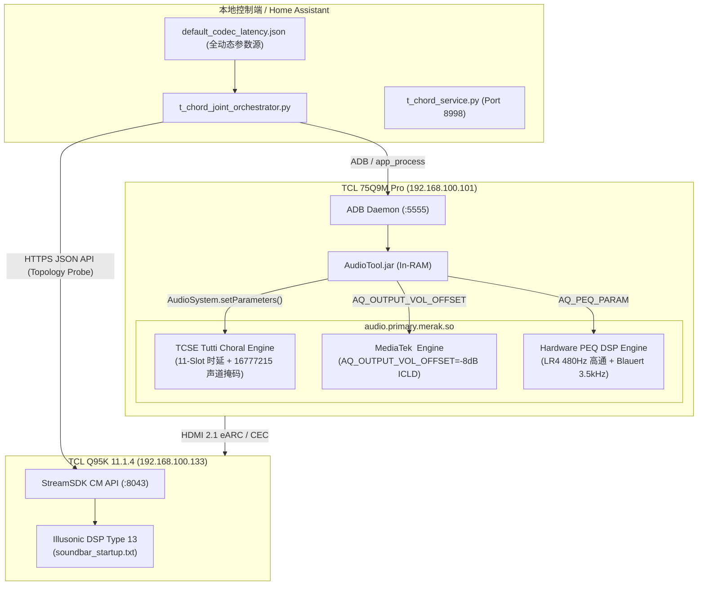

# TCL T-Chord Joint Optimizer (TCL T和弦声学协同优化中枢)

[](LICENSE)
[-orange.svg)](docs/REVERSE_ENGINEERING_TV_HAL.md)
[-blueviolet.svg)](docs/REVERSE_ENGINEERING_SOUNDBAR.md)
[](docs/ACADEMIC_RESEARCH_AND_THEORY.md)
[](https://github.com/EBOLABOY/tcl-tchord-optimizer)
[-success.svg)](#4-安全保障与-100-物理回退承诺)

**TCL T-Chord Joint Optimizer** 是专为 **TCL 旗舰电视（75Q9M Pro / Pentonic 700 / MT9653 / MT9655 平台）** 与 **TCL 旗舰回音壁（Q95K 11.1.4 / Illusonic DSP Type 13 平台）** 打造的高保真声学协同与微秒级相位对齐中枢。

本项目基于**音频工程学会（JAES）声学研究**及对 **MediaTek Audio HAL (`audio.primary.merak.so`)**、**StreamSDK CM 架构** 的全链路逆向工程，破解了底层 T 和弦（Tutti Choral / T-Symphony）隐藏参数矩阵，彻底消除了原厂方案因粗糙时延引起的**垂直梳状滤波相位抵消**、**电视外壳低频共振**与**大屏对白声像下陷**问题。

---

## 1. 为什么需要优化原厂 T 和弦？（理论与痛点）

原厂“T和弦”宣传将电视扬声器与回音壁同时发声作为联合中置，但在实际声学物理中存在根本缺陷：

```
                [ 电视高位微型扬声器 (TV Height) ]
                               ^
                               |  垂直声程差 Δh ≈ 0.85m -> 梳状滤波波谷 (Comb Filter Notch)
                               v
                [ 回音壁主中置声卡 (Soundbar Center) ]
```

| 痛点问题 | 原厂默认声学校准缺陷 | 本项目科学优化方案 (v2.1.0) |
| :--- | :--- | :--- |
| **对白发闷、空洞（梳状滤波）** | 原厂仅通过 HDMI-CEC 粗略估算延迟（误差 10~25ms）。两个相同频段的垂直声源到达人耳存在声程差，在 1 kHz–4 kHz 人声关键频段发生严重反相干涉抵消（Comb Filtering）。 | **11-Slot 编解码微秒相位对齐**：针对 PCM、Dolby Atmos、TrueHD、DTS:X 逐一注入底层硬件时延基准，实现精准同相干涉。 |
| **中低频浑浊与电视塑料共振** | 原厂将未经分频的宽频信号推给电视 10W-15W 微型扬声器，超出其极限冲程（$X_{\max} < 1.2\text{mm}$），引发塑料后盖剧烈共鸣，并与独立 10 吋低音炮产生杂乱低频对冲。 | **Linkwitz-Riley 4阶（24dB/oct）480Hz 高通分频**：电视端切除全部低频与下中频负担，下潜全权交由 Q95K 大口径低音炮呈现。 |
| **通道声级抢占声舞台** | 电视内置喇叭与回音壁平权发声时，电视喇叭过响会抢占主音场，造成立体声舞台收窄与发声点混乱。 | **-8dB ICLD 通道声级差精准衰减**：通过底层硬件指令 `AQ_OUTPUT_VOL_OFFSET=-8;AQ_DEVICE=SpeakerOutput` 下发到 MediaTek `<APAF>` 架构，将电视扬声器压制为弱声像锚点。 |
| **大屏对白声像下陷** | 75 吋大屏下声音全堆在底部回音壁，产生严重“音画下坠脱节感”。 | **Jens Blauert 3.5 kHz 空间高度锚定滤镜**：电视扬声器做 -8dB 辅音抽头，叠加 Blauert 频段提升（+3dB），将人声声像物理“吸附”并锁定在屏幕视觉正中心。 |

> [!NOTE]
> 详细声学学术论文证明与公式推导，请参阅 📄 [声学理论与学术文献深度论证报告](docs/ACADEMIC_RESEARCH_AND_THEORY.md)。

---

## 2. 系统拓扑与逆向工程发现



### 关键逆向工程证据与 Bug 修复 (v2.1.0)
1. **电视端 MediaTek Audio HAL (`audio.primary.merak.so`)**：
   * 在反汇编符号 `_Z17cus_set_parameter`（偏移 `0xe4890`–`0xeb130`）中证实：
     参数 `AQ_TCSE_TUTTI_CHORAL_SBAR_LATENCY` 接收由逗号分隔的字符串，通过 `strtok_r` 和 `atoi` 解析存入音频设备结构体偏移 `0xda6`（十进制 `3494`）的 11 项 16 位整数数组。
   * **消除原厂返回值 Bug**：通过原子捆绑 `AQ_TCSE_TUTTI_CHORAL_SBAR_CHANNEL=16777215`，触发底层 `0xe7e2c` 处的 `mov w21, wzr`，确保函数安全返回 `ret=0`。
2. **底层硬件 ICLD 声级差控制 (`AQ_OUTPUT_VOL_OFFSET`)**：
   * 逆向证实 `AQ_OUTPUT_VOL_OFFSET=-8;AQ_DEVICE=SpeakerOutput` 直通底层 `<APAF>` 硬件引擎 `_MI_LAPAF_FILTER_VOLUME_SetAudioVolParam`，精确控制电视内置喇叭相对于回音壁的衰减偏置。
3. **全动态配置（Dynamic Parameter Passing）**：
   * `configs/default_codec_latency.json` 中的所有分频点（480Hz）、品质因数（Q）、增益（Gain）和声级衰减（-8dB）均由 Python 调度中枢动态解析并传入 `AudioTool`，修改 JSON 即可直接热生效，无需重新编译 Java 代码。
4. **回音壁端与 HDMI-CEC 双端拓扑协同**：
   * 自动探测回音壁 Illusonic DSP Type 13 配置文件、音量与当前 LipSync 时延（若非 0ms 会告警提示）。
   * 自动同步电视系统设置 `tcl_app_settings_multi_sound_device` 与 HDMI-CEC `setsystemaudiomode`。

---

## 3. 快速上手与操作指南

### 环境要求
* 运行环境：局域网内任意常开 Linux / macOS / Windows 主机（Python 3.8+）
* 设备连接：
  * TCL 电视（`192.168.100.101:5555`，已开启 ADB 调试）
  * TCL 回音壁（`192.168.100.133`，通过 HDMI 2.1 eARC 接入电视 HDMI 1 口）

### 常用命令

#### 1. 全自动诊断（检查 TV、回音壁与声学状态）
```bash
python3 t_chord_joint_orchestrator.py --diagnose
```
*输出示例：*
```text
======================================================================
 TCL T-Chord Acoustic & System Comprehensive Diagnostics
======================================================================

--- 1. TV Android & Audio HAL Status ---
[+] TV ADB: ONLINE (Model: Smart TV Pro)
    SoC Platform:         merak
    Build ID:             tcl9655_cn_an64-user 14 UTT2.250416.001 AU01 release-keys
    Multi-Sound Setting:  true
    eARC Mode Setting:    true

--- 2. Q95K Soundbar & HDMI-CEC Link Status ---
[+] Soundbar REST API: ONLINE (Q95K) at https://192.168.100.133:8043
    Illusonic DSP Profile: Type 13 (Q95K 11.1.4 Array)
    Current Volume:        11
    Mute State:            False
    Internal LipSync:      0 ms
    HDMI-CEC Bus State:
      mSystemAudioActivated: true
      CEC: logical_address: 0x05 device_type: 5 display_name: TCL Q95K

--- 3. Dynamic Acoustic Configuration (from JSON) ---
  Index | Codec Type                       | Calibrated Latency
  ------+----------------------------------+-------------------
   [00] | PCM 2.0 (LPCM Linear Stereo)     |  42 ms
   [01] | Dolby Digital (AC-3 5.1)         |  58 ms
   [02] | Dolby Digital Plus (E-AC-3)      |  66 ms
   [03] | Dolby Atmos (E-AC-3 JOC)         |  80 ms
   [04] | Dolby TrueHD Lossless            |  84 ms
   [05] | Dolby TrueHD + Dolby Atmos       |  92 ms
   [06] | Dolby MAT 2.0 / LPCM Multichannel |  74 ms
   [07] | DTS Core 5.1                     |  54 ms
   [08] | DTS-HD Master Audio / DTS:X      |  82 ms

  ICLD Level Balance: -8 dB (TV micro-transducer attenuation)
  PEQ Filter Commands:
    AQ_PEQ_PARAM=1;Fc=480;Type=2;AQ_DEVICE=SpeakerOutput;Q=71;Band=1;Gain=0;Enable=1
    AQ_PEQ_PARAM=1;Fc=480;Type=2;AQ_DEVICE=SpeakerOutput;Q=71;Band=2;Gain=0;Enable=1
    AQ_PEQ_PARAM=1;Fc=3500;Type=0;AQ_DEVICE=SpeakerOutput;Q=150;Band=3;Gain=3;Enable=1
```

#### 2. 一键应用校准配置（零刷机、纯内存注入）
```bash
python3 t_chord_joint_orchestrator.py --apply
```
自动推送已编译好的 `audiotool.jar`，并通过 `app_process` 反射调用 Android 底层 `AudioSystem.setParameters`，瞬时完成 11 槽位时延、-8dB ICLD 偏置、480Hz 高通分频与 Blauert 人声抬升滤镜注入。

#### 3. 恢复出厂默认设置
```bash
python3 t_chord_joint_orchestrator.py --restore
```

#### 4. 查看当前校准参数 JSON
```bash
python3 t_chord_joint_orchestrator.py --show-params
```

---

## 4. 安全保障与 100% 物理回退承诺

本工具严格遵守非破坏性设计原则：

> [!IMPORTANT]
> 1. **零磁盘修改（Zero Flash Write）**：全程**绝对不修改**系统的任何只读系统镜像或驱动二进制（`/system`、`/vendor`、`/boot` 保持 100% 原始只读状态），完全不触碰 Android AVB 2.0 / dm-verity 校验，**绝对不会出现黑屏、卡标或变砖问题**。
> 2. **纯内存（In-RAM Volatile）注入**：所有 PEQ 滤波器及编解码时延数组只常驻于 Linux 进程的当前物理内存堆中。
> 3. **物理断电/重启即归零（Reboot-to-Factory）**：若需完全撤销调优，直接执行 `--restore`，或者**重启电视/拔掉电源**，系统立即彻底恢复至官方出厂状态。

---

## 5. Home Assistant 自动化与开机自愈

本项目提供了后台服务 `scripts/t_chord_service.py`，支持：
* **开机自愈**：通过 HA WebSocket 监听电视状态，电视开机 3.5 秒内自动全静默注入。
* **Mushroom 赛博朋克仪表盘**：实时展示优化状态、11 种时延与分频数值，支持一键点按重新校准。
* **环境变量与参数化配置**：全面移除硬编码，支持 `--ha-host`、`--ha-token`、`--tv-ip` 自由指定。
* 详见 📄 [Home Assistant 自动化集成指南](docs/HOME_ASSISTANT_INTEGRATION.md)。

---

## 6. 项目目录结构

```
├── configs/
│   └── default_codec_latency.json      # 11 编解码器时延基准、-8dB ICLD 与 PEQ 分频配置 (全动态源)
├── docs/
│   ├── ACADEMIC_RESEARCH_AND_THEORY.md # 声学理论、梳状滤波消除与 JAES 论文证明
│   ├── ACOUSTIC_TUNING_GUIDE.md        # 室内空间声学计算与分频调音指南
│   ├── HOME_ASSISTANT_INTEGRATION.md   # Home Assistant 自动化与状态监控集成指南
│   ├── REVERSE_ENGINEERING_SOUNDBAR.md # 回音壁 StreamSDK 与 Illusonic DSP 深度分析
│   └── REVERSE_ENGINEERING_TV_HAL.md   # 电视 MediaTek Audio HAL 反汇编分析 (含 APAF ICLD 分析)
├── injector/
│   ├── bin/
│   │   ├── audiotool.dex               # 编译生成的高效 Android DEX 字节码
│   │   └── audiotool.jar               # 独立打包的免安装可执行工具包 (支持动态传参)
│   └── src/
│       └── AudioTool.java              # 纯内存 AudioSystem 反射调用注入器 (无任何假反射)
├── scripts/
│   ├── t_chord_service.py              # Home Assistant 联动后台常驻守护服务 (无硬编码)
│   └── tcl-tchord.service              # Systemd 服务单元定义文件
├── t_chord_joint_orchestrator.py       # 联合声学优化调度与命令行中枢 (CLI, 动态解析 JSON)
├── LICENSE                             # MIT 开源协议
└── README.md                           # 项目说明文档
```

---

## 7. 学术参考文献 (References)

1. **Wallis, R., & Lee, H. (2015)**. *The Effect of Interchannel Time Difference on the Elevation Perception of Vertical Stereophony*. **Journal of the Audio Engineering Society (JAES)**, 63(10), 767–776.
2. **Blauert, J. (1997)**. *Spatial Hearing: The Psychophysics of Human Sound Localization* (Revised Edition). **MIT Press**, Cambridge, MA.
3. **Bertelson, P., & de Gelder, B. (2004)**. *The psychology of multimodal perception*. In C. Spence & J. Driver (Eds.), *Crossmodal Space and Crossmodal Attention* (pp. 141–177). **Oxford University Press**.
4. **Linkwitz, S. (1976)**. *Active Crossover Networks for Noncoincident Drivers*. **JAES**, 24(1), 2–8.

---

## 8. 开源协议

本项目基于 [MIT 协议](LICENSE) 开源。仅供家庭影院与多声道声学校准爱好者研究学习使用。
